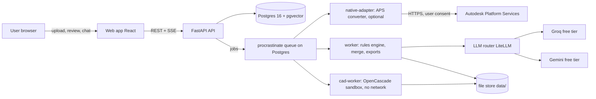
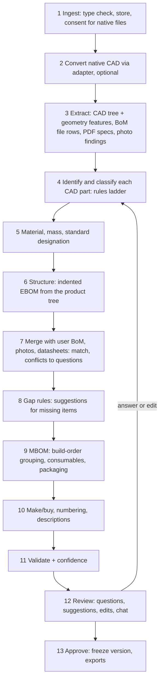

# 02 — Architecture and tech stack

## 1. System context

## 2. Components

| Component | Responsibility |
|---|---|
| `apps/web` | Upload wizard, progress, 3D viewer, review table, questions, chat panel, exports |
| `apps/api` | Jobs, uploads (type/size checks), SSE progress, review edits, approvals, exports, library admin endpoints |
| `apps/worker` | Runs the BoM pipeline (doc 04) as jobs; calls `cad-worker` and the LLM router |
| `apps/cad-worker` | OpenCascade (OCP/CadQuery) extraction of STEP: tree, metadata, geometry features, GLB; separate container with no network and resource limits |
| `apps/native-adapter` | Converts SLDPRT/SLDASM/F3D through APS Model Derivative; off unless configured; only after user consent |
| `packages/domain` | Pydantic models, `Prov[T]`, validators, JSON Schema → TS types |
| `packages/rules` | Deterministic rules engine: recognisers, classifiers, merge, gap rules, EBOM→MBOM, numbering, confidence; no LLM imports |
| `packages/agents` | LLM router roles, fallback steps, agent (summaries, questions, chat), cassettes |
| `packages/library` | Loader, validation and tests for `library/` YAML; versioning; search index |
| `library/` | Taxonomy, synonyms, materials, standard-part tables, gap rules, header synonyms, numbering schemes (doc 06) |

## 3. Pipeline (one job per upload set)

- Steps 3–11 are deterministic except where the fallback ladder (doc 04 §9) calls an LLM role.
- Answering a question or editing a line re-runs only the affected steps for the affected lines (dependency tracking by line).
- Each approval creates an immutable BoM version; exports always reference a version.

## 4. LLM roles (via LiteLLM router)

| Role | Default (free tier) | Fallback | Used for | Never used for |
|---|---|---|---|---|
| `reasoner` | Groq large open model | Gemini | Classifying a part the rules could not classify; proposing gap candidates for an unknown product type; resolving ambiguous header mappings | Quantities, dimensions, masses, costs |
| `extractor` | Groq small fast model | `reasoner` | Pulling specs from PDF text; parsing a messy BoM table when rules fail; reading text the user typed | Inventing values not in the source text |
| `vision` | Gemini | none (photo step skipped with a notice) | Listing visible components, counts, labels and markings from photos | Dimensions from photos |
| `agent` | Groq large model | `reasoner` | Job summary, question wording, explaining a line, chat answers grounded in the job data | Changing BoM data directly (it can only propose an edit that goes through the same rules and user approval) |

- Model names live in config. Per-role RPM/TPM budgets, 429 backoff, fallback role, per-job token budget (default 40k tokens; most jobs should use far less).
- Prompts receive IDs and compact facts; every call logged (role, model, tokens, latency, `fallback_reason`, job, line).

## 5. Tech stack

| Layer | Choice | Why |
|---|---|---|
| Language (backend) | Python 3.12, uv workspaces | OpenCascade bindings, data tooling, same as the platform |
| API | FastAPI + Pydantic v2, SSE for progress | Typed I/O, JSON Schema export |
| Jobs | procrastinate on Postgres | No extra broker; proven in the platform P0 (fast start, heartbeat recovery) |
| Database | Postgres 16 + pgvector | Jobs, BoM versions as JSONB, library, search |
| CAD | OCP / CadQuery (OpenCascade 7.x): STEPCAFControl + XCAF for tree, names, colours, layers, properties; BRepGProp for mass properties; BRepAdaptor for face types; tessellation → GLB via trimesh | Free, reads AP203/214/242 with assembly structure |
| Native CAD | Autodesk Platform Services Model Derivative (optional adapter) | Translates Fusion F3D to STEP; SolidWorks to viewable derivatives plus model properties (see doc 03 §2) |
| Geometry helpers | numpy, trimesh, scipy (OBB, symmetry tests) | Feature checks for recognisers |
| Tables | openpyxl, pandas (CSV/XLSX), pdfplumber (PDF tables/text) | Free, robust |
| Matching | rapidfuzz (string similarity), unidecode, regex dictionaries from the library | Deterministic fuzzy matching |
| Units | pint | Unit normalisation |
| Rules | Own rules engine over YAML (doc 04 §2), safe expression evaluator (simpleeval-style, whitelisted) | Rules as data, explainable by id |
| Orchestration | Plain pipeline in `apps/worker` with per-step checkpoints in Postgres; LangGraph only inside `packages/agents` for the chat agent | The pipeline is deterministic; a graph framework is only worth it for the conversational part |
| LLM | LiteLLM router → Groq + Gemini free tiers | Free, swappable |
| Web | React + Vite + TS, TanStack Table, React Three Fiber (three.js) for GLB, Radix UI primitives, design tokens | Fast editable grid, accessible components |
| Exports | openpyxl (XLSX), csv, JSON, WeasyPrint (PDF parts list) | Free |
| Deploy | Docker Compose, multi-arch images, Caddy; Oracle Always Free Ampere or any small VM | Free POC hosting |

## 6. Security and privacy

- Uploads checked by magic bytes and extension, size limits (CAD 200 MB, others 25 MB, configurable), stored under `data/jobs/<id>/` outside the web root.
- `cad-worker` runs with no network, read-only root, CPU 2 / RAM 3 GB / 120 s per file (configurable), killed on overrun.
- Native conversion sends the file to Autodesk; the UI asks for consent per job, and the setting can be disabled entirely.
- LLM calls receive only the facts needed (names, class candidates, short text snippets), never whole files; photos go to the `vision` role only if the user enables photo analysis.
- Jobs are reachable through an unguessable link; retention 30 days (configurable); ZIP export of everything.
